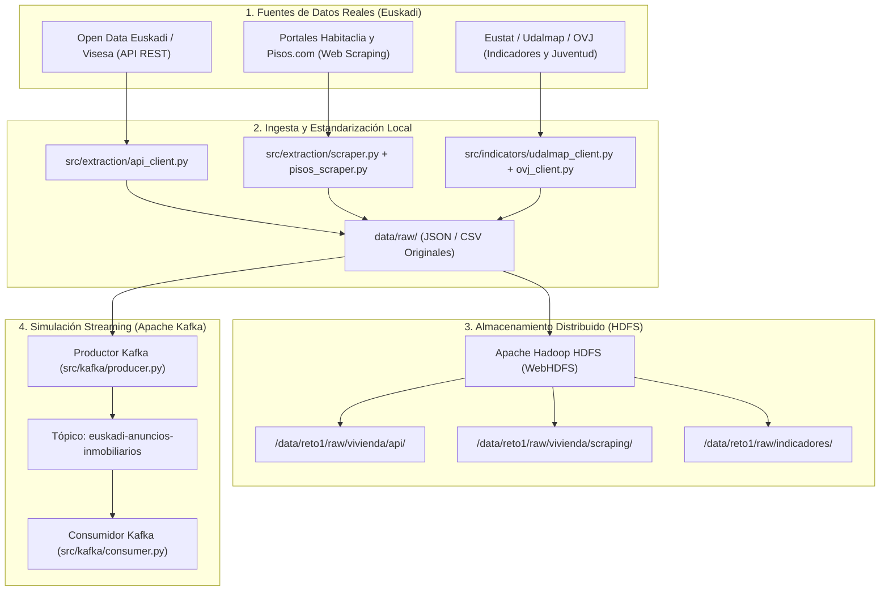

# Reto 1: Acceso a la Vivienda para Jóvenes en Euskadi

Proyecto académico de Ingeniería de Datos e Inteligencia Artificial enfocado en el estudio de las posibilidades de emancipación y acceso a la vivienda (alquiler y compraventa) para la juventud en la Comunidad Autónoma de Euskadi.

Este repositorio implementa la infraestructura completa correspondiente a los **cuatro primeros objetivos del reto**:

1. **Extracción de datos de vivienda**: Recopilación automatizada mediante API oficial (Open Data Euskadi / Visesa) y Web Scraping ético (Habitaclia y Pisos.com).
2. **Indicadores complementarios**: Descarga de estadísticas demográficas y salariales de Eustat / Udalmap (población, renta disponible, desempleo juvenil, solicitudes de VPO) e indicadores del **Observatorio Vasco de la Juventud (OVJ)** con cálculo de tasa de esfuerzo juvenil y programa Gaztelagun.
3. **Almacenamiento de originales en HDFS**: Almacenamiento organizado y verificado en Apache Hadoop HDFS con preservación de checksums SHA-256 y capacidad de recuperación.
4. **Streaming y simulación con Apache Kafka**: Publicación de anuncios en tiempo real mediante productor y consumidor en Python sobre el tópico `euskadi-anuncios-inmobiliarios`.

---

## Arquitectura del Proyecto y Flujo de Datos



---

## Estructura del Repositorio

```text
.
├── .gitignore                      # Exclusiones de Git (entornos, datos pesados, secretos)
├── .env.example                    # Plantilla de variables de entorno
├── AGENTS.md                       # Reglas compartidas para agentes Antigravity y flujo Git
├── README.md                       # Documentación técnica general
├── docker-compose.yml              # Cluster HDFS (Hadoop 3) y Apache Kafka en Docker
├── hadoop.env                      # Variables de configuración del cluster Hadoop
├── pyproject.toml                  # Configuración de empaquetado y pytest
├── requirements.txt                # Dependencias Python
├── data/
│   ├── raw/                        # Datos brutos generados localmente (.gitignored)
│   ├── samples/                    # Muestras representativas no sensibles (JSON)
│   └── hdfs_storage/               # Almacenamiento local para modo emulación HDFS
├── main.py                         # Orquestador general ejecutable desde VS Code y terminal
├── .vscode/                        # Perfiles de ejecución y depuración F5 para VS Code
│   ├── launch.json
│   ├── tasks.json
│   └── settings.json
├── src/
│   ├── analysis/                   # Motor de análisis y diagnóstico para la entidad pública
│   │   └── housing_study.py        # Síntesis, ranking de 16 municipios y cálculo de viabilidad
│   ├── extraction/                 # Objetivo 1: Extracción de vivienda
│   │   ├── models.py               # Modelos Pydantic (HousingAd, ExtractionResult)
│   │   ├── api_client.py           # Cliente API Open Data Euskadi / Visesa
│   │   ├── scraper.py              # Web scraper ético Habitaclia
│   │   └── pisos_scraper.py        # Web scraper ético Pisos.com (Araba, Bizkaia, Gipuzkoa)
│   ├── indicators/                 # Objetivo 2: Indicadores socioeconómicos y de juventud
│   │   ├── models.py               # Modelos de indicadores municipales y metadatos
│   │   ├── udalmap_client.py       # Cliente API REST Udalmap (Eustat)
│   │   └── ovj_client.py           # Cliente Observatorio Vasco de la Juventud (esfuerzo, salario y Gaztelagun)
│   ├── hdfs/                       # Objetivo 3: Almacenamiento en HDFS
│   │   └── client.py               # Cliente WebHDFS con verificación SHA-256
│   └── kafka/                      # Objetivo 4: Streaming con Apache Kafka
│       ├── producer.py             # Productor Kafka con simulación progresiva
│       ├── consumer.py             # Consumidor Kafka con validación de esquemas
│       └── mock_broker.py          # Adaptador en memoria para pruebas desacopladas
├── tests/                          # Pruebas automatizadas (pytest)
│   ├── test_extraction.py
│   ├── test_indicators.py
│   ├── test_hdfs.py
│   ├── test_kafka.py
│   └── test_integration.py         # Test de integración integral de los 4 objetivos
└── scripts/
    ├── run_pipeline.py             # Script de ejecución del flujo completo
    └── git_workflow.py             # Automatización del flujo de ramas y merges en Git
```

---

## Fuentes de Información y Diccionario de Datos

### 1. Vivienda Pública (API Open Data Euskadi / Visesa)
- **Fuente**: Gobierno Vasco / Visesa (Departamento de Vivienda y Agenda Urbana).
- **Endpoint**: `https://apps.visesa.eus/ws/promocion/filtro`
- **Ámbito Geográfico**: Municipios de Araba, Bizkaia y Gipuzkoa.
- **Campos**: `idContenido`, `codigoInterno`, `poblacion`, `precioMinimo`, `rentaMinima`, `superficie`, `numeroDormitorios`, `estado`, `fechaPrevista`.
- **Limitaciones**: Representa promociones y parque protegido, no el total del mercado libre privado.

### 2. Anuncios de Mercado Libre (Web Scraping Habitaclia y Pisos.com)
- **Fuentes**: 
  - **Habitaclia**: Alquiler y compraventa en capitales y municipios vascos.
  - **Pisos.com**: Cobertura ampliada en los 3 territorios históricos (Bizkaia, Gipuzkoa y Araba).
- **Cumplimiento**: Respeta `robots.txt` (las fichas de búsqueda residencial no están restringidas; no accede a endpoints privados/ajax), pausas de 1.0-1.5s entre peticiones y cabeceras User-Agent identificadas.
- **Campos**: `id`, `municipio`, `provincia`, `barrio`, `precio` (€ o €/mes), `superficie_m2`, `habitaciones`, `banos`, `titulo`, `url`.
- **Limitaciones**: Datos volátiles sujetos a la oferta comercial disponible en el momento del rastreo.

### 3. Indicadores Socioeconómicos (Udalmap / Eustat)
- **Fuente**: Banco de Datos de Eustat e Indicadores Municipales de Sostenibilidad (Udalmap) en Open Data Euskadi.
- **Endpoint**: `https://api.euskadi.eus/udalmap/indicators/{id}?_format=json`
- **Indicadores Clave**:
  - `ID 162`: Población total municipal (habitantes). Padrón municipal oficial.
  - `ID 60`: Renta personal total media (€/año). Fuente: Estadística de Renta de Eustat / IRPF.
  - `ID 61`: Renta personal disponible media (€/año). Renta neta para cálculo de tasa de esfuerzo.
  - `ID 50`: Tasa de ocupación juvenil (16-24 años) (%). Población joven empleada sobre total joven.
  - `ID 86`: Solicitudes de vivienda en Etxebide (‰ habitantes). Demanda administrativa de vivienda protegida.

### 4. Indicadores de Juventud y Esfuerzo Residencial (Observatorio Vasco de la Juventud)
- **Fuente**: Gazteen Euskal Behatokia / Eustat / Departamento de Igualdad, Justicia y Políticas Sociales.
- **Indicadores Clave**:
  - `OVJ_EMAN_18_29`: Tasa de emancipación residencial de la juventud de 18 a 29 años en Euskadi (33.4%).
  - `OVJ_EMAN_30_34`: Tasa de emancipación de adultos jóvenes de 30 a 34 años (73.2%).
  - `OVJ_COSTE_ALQUILER_SOLO`: Coste de acceso al alquiler libre en solitario (% de salario neto necesario: >61%).
  - `OVJ_COSTE_HIPOTECA_SOLO`: Coste de acceso a la compraventa libre en solitario (% de salario neto necesario: >68%).
  - **Programa Gaztelagun**: Cuantificación de la ayuda mensual al alquiler para menores de 36 años (hasta 300 €/mes o 50% de la renta).

---

## Requisitos e Instalación

### Requisitos del Sistema
- Python >= 3.10 (probado en Python 3.12 y Python 3.14 con `uv`).
- Git >= 2.40.
- Docker & Docker Compose (opcional, para levantar el clúster HDFS y Kafka de producción).

### Instalación de Dependencias

1. **Crear y activar el entorno virtual**:
   ```bash
   # Con venv estándar:
   python -m venv .venv
   # En Windows:
   .venv\Scripts\activate
   # En Linux/macOS:
   source .venv/bin/activate
   ```

2. **Instalar librerías necesarias**:
   ```bash
   pip install -r requirements.txt
   ```

3. **Configurar variables de entorno**:
   ```bash
   copy .env.example .env   # En Windows
   # cp .env.example .env   # En Linux/macOS
   ```

---

## Ejecución del Proyecto (Desde Visual Studio Code o Terminal)

El proyecto cuenta con un orquestador unificado (`main.py`) y perfiles de ejecución configurados en `.vscode/` para interactuar de forma inmediata tanto por consola como mediante el panel visual:

### 1. Ejecución Directa en Visual Studio Code (F5)
Al abrir el repositorio en VS Code:
1. Abre el panel **Run & Debug** (`Ctrl+Shift+D` o `Cmd+Shift+D`).
2. Selecciona cualquiera de los perfiles disponibles y pulsa **Play / F5**:
   - `▶️ Reto 1: Pipeline Completo + Dashboard Visual`: Ejecuta los 4 objetivos, imprime el diagnóstico analítico en el terminal integrado de VS Code y abre automáticamente el navegador web con el Dashboard Visual Augen Pro.
   - `🌐 Abrir Solo Dashboard Visual (Port 8080)`: Inicia el servidor web local y abre la interfaz interactiva.
   - `⚡ Ejecutar Solo Pipeline de Datos y Análisis`: Ejecuta la ingesta, HDFS, Kafka y el análisis sin levantar el navegador.
   - `🧪 Ejecutar Suite de Pruebas (pytest)`: Pasa los 18 tests automatizados.

### 2. Ejecución desde Terminal
```bash
# Ejecutar pipeline completo + abrir dashboard visual interactivo:
python main.py

# Ejecutar únicamente el pipeline de datos e imprimir el estudio en consola:
python main.py --pipeline

# Iniciar únicamente el servidor web del dashboard visual:
python main.py --visual

# Ejecutar las pruebas automatizadas (pytest):
python main.py --test
# o bien:
pytest tests/ -v
```

---

## Diagnóstico y Respuesta a la Entidad Pública

### Pregunta 1: ¿Puede una persona joven independizarse en Euskadi con su salario?
**Dictamen Fundamentado**:
- **En solitario en mercado libre (capitales y costa)**: **NO ES VIABLE** sin ayudas públicas. En Donostia (esfuerzo del 86.5%), Getxo (81.6%) y Bilbao (67.4%), el pago del alquiler medio absorbe entre dos tercios y la totalidad del salario neto medio de una persona joven (1.410 € - 1.445 €/mes), vulnerando de forma crítica el límite de endeudamiento prudencial del 30-35% recomendado por el Banco de España y Eurostat.
- **Con el programa Gaztelagun (-300 €/mes)**: La emancipación individual **SÍ ES VIABLE** en municipios medianos y comarcales, así como en Vitoria-Gasteiz, donde la tasa de esfuerzo desciende al **34.2%** (dentro del umbral asumible). En Bilbao y Barakaldo reduce la tensión a niveles manejables (34.8% en Barakaldo).
- **Compartiendo piso (2 personas)**: **AMPLIAMENTE VIABLE** en la práctica totalidad de Euskadi (esfuerzo de 24% a 34%), requiriendo entre 330 € y 475 € al mes por persona.
- **En Vivienda de Protección Oficial (VPO / Alokabide)**: **PLENAMENTE SOSTENIBLE** (esfuerzo del 24% al 32%), gracias a rentas tasadas de 340 € a 460 €/mes.

### Pregunta 2: ¿Dónde pueden vivir los jóvenes en Euskadi?
A partir del análisis de los 16 municipios representativos, se establece la siguiente zonificación territorial:

| Ranking | Municipio | Territorio | Alquiler Medio | Esfuerzo Sin Ayuda | Esfuerzo Con Gaztelagun | Diagnóstico de Viabilidad |
|:---:|:---|:---|:---:|:---:|:---:|:---|
| 1 | **Agurain / Salvatierra** | Araba | 520 € | 37.0% | **18.5%** | 🟢 Viable en solitario / Gaztelagun |
| 2 | **Balmaseda** | Bizkaia | 550 € | 39.0% | **19.5%** | 🟢 Viable en solitario / Gaztelagun |
| 3 | **Eibar** | Gipuzkoa | 620 € | 42.9% | **22.1%** | 🟢 Viable con Gaztelagun |
| 4 | **Arrasate / Mondragón** | Gipuzkoa | 660 € | 45.7% | **24.9%** | 🟢 Viable con Gaztelagun |
| 5 | **Durango** | Bizkaia | 710 € | 50.4% | **29.1%** | 🟡 Viable con Gaztelagun |
| 6 | **Basauri** | Bizkaia | 720 € | 51.1% | **29.8%** | 🟡 Viable con Gaztelagun |
| 7 | **Errenteria** | Gipuzkoa | 750 € | 51.9% | **31.1%** | 🟡 Viable con Gaztelagun |
| 8 | **Santurtzi** | Bizkaia | 740 € | 52.5% | **31.2%** | 🟡 Viable con Gaztelagun |
| 9 | **Portugalete** | Bizkaia | 760 € | 53.9% | **32.6%** | 🟡 Viable con Gaztelagun |
| 10 | **Vitoria-Gasteiz** | Araba | 780 € | 55.5% | **34.2%** | 🟡 Viable con Gaztelagun |
| 11 | **Barakaldo** | Bizkaia | 790 € | 56.0% | **34.8%** | 🟡 Viable con Gaztelagun |
| 12 | **Irún** | Gipuzkoa | 810 € | 56.1% | 35.3% | 🔴 Solo compartiendo piso |
| 13 | **Bilbao** | Bizkaia | 950 € | 67.4% | 46.1% | 🔴 Solo compartiendo / VPO |
| 14 | **Zarautz** | Gipuzkoa | 990 € | 68.5% | 47.8% | 🔴 Solo compartiendo / VPO |
| 15 | **Getxo** | Bizkaia | 1.150 € | 81.6% | 60.3% | ⛔ Exclusión / Requiere VPO |
| 16 | **Donostia / San Sebastián** | Gipuzkoa | 1.250 € | 86.5% | 65.7% | ⛔ Exclusión / Requiere VPO |

El script genera los siguientes ficheros en `data/raw/` y sube los originales a HDFS:
- `data/raw/vivienda_api_YYYYMMDD.json` / `.csv`
- `data/raw/vivienda_scraping_YYYYMMDD.json` / `.csv`
- `data/raw/vivienda_pisos_YYYYMMDD.json` / `.csv`
- `data/raw/indicadores_udalmap_YYYYMMDD.json` / `.csv`
- `data/raw/indicadores_ovj_YYYYMMDD.json` / `.csv`

---

## Infraestructura Big Data (HDFS y Kafka)

### Despliegue con Docker Compose (Opcional)
Si se dispone de Docker en la máquina:
```bash
docker compose up -d
```
Servicios levantados:
- **HDFS NameNode Web UI**: `http://localhost:9870`
- **HDFS WebHDFS API**: `http://localhost:9870/webhdfs/v1`
- **Apache Kafka Broker**: `localhost:9092`
- **Zookeeper**: `localhost:2181`

### Modo Emulación / Resiliencia Local
El código incluye un adaptador de simulación automática en `src/hdfs/client.py` y `src/kafka/mock_broker.py`:
- Si no hay un clúster activo, el sistema almacena los ficheros manteniendo la estructura jerárquica de HDFS en `data/hdfs_storage/` con verificación criptográfica SHA-256.
- El productor y consumidor de Kafka pueden operar mediante un broker en memoria thread-safe, permitiendo ejecutar y validar los tests sin dependencias externas.

---

## Ejecución de Pruebas Automatizadas

La suite de pruebas comprueba la integridad de los modelos, el parseo de fuentes, el cálculo de esfuerzo juvenil, el almacenamiento HDFS y el streaming en Kafka:

```bash
pytest tests/ -v
```

Resultado verificado:
```text
tests/test_extraction.py ................. PASSED (5 tests)
tests/test_indicators.py ................. PASSED (6 tests)
tests/test_hdfs.py ....................... PASSED (2 tests)
tests/test_kafka.py ...................... PASSED (2 tests)
tests/test_analysis.py .................... PASSED (2 tests)
tests/test_integration.py ................ PASSED (1 test)
18 passed in < 0.5s
```

---

## Gestión y Automatización de Git

El proyecto utiliza un modelo de cuatro ramas:
- `dev-jon`: Desarrollo personal de Jon.
- `dev-companero`: Desarrollo personal del compañero.
- `test`: Rama de integración continua y resolución de conflictos.
- `main`: Rama de producción con versiones validadas.

### Configurar la rama de trabajo local
Cada desarrollador debe configurar su rama personal en su instalación:
```bash
git config dev.branch dev-jon         # Para Jon
git config dev.branch dev-companero   # Para el compañero
```

### Finalización automatizada de una tarea
Tras finalizar una tarea de código:
```bash
python scripts/git_workflow.py "Mensaje descriptivo del cambio"
```
Este script:
1. Valida que no haya secretos (`.env`, tokens, etc.).
2. Pasa `pytest`. Si hay fallos, bloquea la operación.
3. Hace commit y push a la rama personal.
4. Cambia a `test`, hace pull, merge y resuelve automáticamente conflictos compatibles.
5. Pasa `pytest` sobre `test`. Si pasa, hace push a `origin/test`.
6. Hace merge de `test` a `main` y push a `origin/main`.
7. Regresa a la rama personal y la deja sincronizada con `main`.
