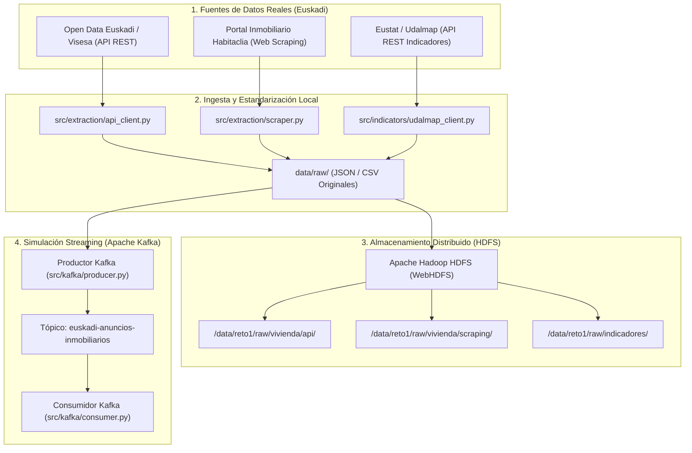

# Reto 1: Acceso a la Vivienda para Jóvenes en Euskadi

Proyecto académico de Ingeniería de Datos e Inteligencia Artificial enfocado en el estudio de las posibilidades de emancipación y acceso a la vivienda (alquiler y compraventa) para la juventud en la Comunidad Autónoma de Euskadi.

Este repositorio implementa la infraestructura completa correspondiente a los **cuatro primeros objetivos del reto**:

1. **Extracción de datos de vivienda**: Recopilación automatizada mediante API oficial (Open Data Euskadi / Visesa) y Web Scraping ético (Habitaclia).
2. **Indicadores complementarios**: Descarga de estadísticas demográficas y salariales de Eustat / Udalmap (población, renta disponible, desempleo juvenil, solicitudes de VPO).
3. **Almacenamiento de originales en HDFS**: Almacenamiento organizado y verificado en Apache Hadoop HDFS con preservación de checksums SHA-256 y capacidad de recuperación.
4. **Streaming y simulación con Apache Kafka**: Publicación de anuncios en tiempo real mediante productor y consumidor en Python sobre el tópico `euskadi-anuncios-inmobiliarios`.

---

## Arquitectura del Proyecto y Flujo de Datos



---

## Estructura del Repositorio

```text
.
├── .gitignore                      # Exclusiones de Git (entornos, datos pesados, secretos)
├── .env.example                    # Plantilla de variables de entorno
├── AGENTS.md                       # Reglas compartidas para agentes Antigravity y flujo Git
├── README.md                       # Documentación técnica general
├── docker-compose.yml              # Cluster HDFS (Hadoop 3) y Apache Kafka en Docker
├── hadoop.env                      # Variables de configuración del cluster Hadoop
├── pyproject.toml                  # Configuración de empaquetado y pytest
├── requirements.txt                # Dependencias Python
├── data/
│   ├── raw/                        # Datos brutos generados localmente (.gitignored)
│   ├── samples/                    # Muestras representativas no sensibles (JSON)
│   └── hdfs_storage/               # Almacenamiento local para modo emulación HDFS
├── src/
│   ├── extraction/                 # Objetivo 1: Extracción de vivienda
│   │   ├── models.py               # Modelos Pydantic (HousingAd, ExtractionResult)
│   │   ├── api_client.py           # Cliente API Open Data Euskadi / Visesa
│   │   └── scraper.py              # Web scraper ético con BeautifulSoup
│   ├── indicators/                 # Objetivo 2: Indicadores socioeconómicos
│   │   ├── models.py               # Modelos de indicadores municipales y metadatos
│   │   └── udalmap_client.py       # Cliente API REST Udalmap (Eustat)
│   ├── hdfs/                       # Objetivo 3: Almacenamiento en HDFS
│   │   └── client.py               # Cliente WebHDFS con verificación SHA-256
│   └── kafka/                      # Objetivo 4: Streaming con Apache Kafka
│       ├── producer.py             # Productor Kafka con simulación progresiva
│       ├── consumer.py             # Consumidor Kafka con validación de esquemas
│       └── mock_broker.py          # Adaptador en memoria para pruebas desacopladas
├── tests/                          # Pruebas automatizadas (pytest)
│   ├── test_extraction.py
│   ├── test_indicators.py
│   ├── test_hdfs.py
│   ├── test_kafka.py
│   └── test_integration.py         # Test de integración integral de los 4 objetivos
└── scripts/
    ├── run_pipeline.py             # Script de ejecución del flujo completo
    └── git_workflow.py             # Automatización del flujo de ramas y merges en Git
```

---

## Fuentes de Información y Diccionario de Datos

### 1. Vivienda Pública (API Open Data Euskadi / Visesa)
- **Fuente**: Gobierno Vasco / Visesa (Departamento de Vivienda y Agenda Urbana).
- **Endpoint**: `https://apps.visesa.eus/ws/promocion/filtro`
- **Ámbito Geográfico**: Municipios de Araba, Bizkaia y Gipuzkoa.
- **Campos**: `idContenido`, `codigoInterno`, `poblacion`, `precioMinimo`, `rentaMinima`, `superficie`, `numeroDormitorios`, `estado`, `fechaPrevista`.
- **Limitaciones**: Representa promociones y parque protegido, no el total del mercado libre privado.

### 2. Anuncios de Mercado Libre (Web Scraping Habitaclia)
- **Fuente**: Habitaclia (alquiler y compraventa en capitales y municipios vascos).
- **Cumplimiento**: Respeta `robots.txt` (las fichas de búsqueda residencial no están restringidas; no accede a endpoints privados/ajax), pausas de 1.5s entre peticiones y cabecera User-Agent identificada.
- **Campos**: `id`, `municipio`, `barrio`, `precio` (€ o €/mes), `superficie_m2`, `habitaciones`, `banos`, `titulo`, `url`.
- **Limitaciones**: Datos volátiles sujetos a la oferta comercial disponible en el momento del rastreo.

### 3. Indicadores Socioeconómicos (Udalmap / Eustat)
- **Fuente**: Banco de Datos de Eustat e Indicadores Municipales de Sostenibilidad (Udalmap) en Open Data Euskadi.
- **Endpoint**: `https://api.euskadi.eus/udalmap/indicators/{id}?_format=json`
- **Indicadores Clave**:
  - `ID 162`: Población total municipal (habitantes). Padrón municipal oficial.
  - `ID 60`: Renta personal total media (€/año). Fuente: Estadística de Renta de Eustat / IRPF.
  - `ID 61`: Renta personal disponible media (€/año). Renta neta para cálculo de tasa de esfuerzo.
  - `ID 50`: Tasa de ocupación juvenil (16-24 años) (%). Población joven empleada sobre total joven.
  - `ID 86`: Solicitudes de vivienda en Etxebide (‰ habitantes). Demanda administrativa de vivienda protegida.
- **Limitaciones**: Las estadísticas fiscales de renta presentan un desfase de publicación habitual de 1-2 años respecto al censo en tiempo real.

---

## Requisitos e Instalación

### Requisitos del Sistema
- Python >= 3.10 (probado en Python 3.12 y Python 3.14 con `uv`).
- Git >= 2.40.
- Docker & Docker Compose (opcional, para levantar el clúster HDFS y Kafka de producción).

### Instalación de Dependencias

1. **Crear y activar el entorno virtual**:
   ```bash
   # Con venv estándar:
   python -m venv .venv
   # En Windows:
   .venv\Scripts\activate
   # En Linux/macOS:
   source .venv/bin/activate
   ```
   *(O utilizando `uv`: `uv venv .venv` y `.venv\Scripts\activate`)*

2. **Instalar librerías necesarias**:
   ```bash
   pip install -r requirements.txt
   # O con uv:
   uv pip install -r requirements.txt
   ```

3. **Configurar variables de entorno**:
   ```bash
   copy .env.example .env   # En Windows
   # cp .env.example .env   # En Linux/macOS
   ```

---

## Ejecución del Pipeline Integral

Para ejecutar de principio a fin la extracción real, descarga de indicadores, guardado en HDFS y streaming con Kafka:

```bash
python scripts/run_pipeline.py
```

El script genera los siguientes ficheros en `data/raw/` y sube los originales a HDFS:
- `data/raw/vivienda_api_YYYYMMDD.json` / `.csv`
- `data/raw/vivienda_scraping_YYYYMMDD.json` / `.csv`
- `data/raw/indicadores_udalmap_YYYYMMDD.json` / `.csv`

---

## Infraestructura Big Data (HDFS y Kafka)

### Despliegue con Docker Compose (Opcional)
Si se dispone de Docker en la máquina:
```bash
docker compose up -d
```
Servicios levantados:
- **HDFS NameNode Web UI**: `http://localhost:9870`
- **HDFS WebHDFS API**: `http://localhost:9870/webhdfs/v1`
- **Apache Kafka Broker**: `localhost:9092`
- **Zookeeper**: `localhost:2181`

### Modo Emulación / Resiliencia Local
El código incluye un adaptador de simulación automática en `src/hdfs/client.py` y `src/kafka/mock_broker.py`:
- Si no hay un clúster activo, el sistema almacena los ficheros manteniendo la estructura jerárquica de HDFS en `data/hdfs_storage/` con verificación criptográfica SHA-256.
- El productor y consumidor de Kafka pueden operar mediante un broker en memoria thread-safe, permitiendo ejecutar y validar los tests sin dependencias externas.

---

## Ejecución de Pruebas Automatizadas

La suite de pruebas comprueba la integridad de los modelos, el parseo de fuentes, el almacenamiento HDFS y el streaming en Kafka:

```bash
pytest tests/ -v
```

Resultado esperado:
```text
tests/test_extraction.py ................. PASSED
tests/test_indicators.py ................. PASSED
tests/test_hdfs.py ....................... PASSED
tests/test_kafka.py ...................... PASSED
tests/test_integration.py ................ PASSED
12 passed in < 1s
```

---

## Gestión y Automatización de Git

El proyecto utiliza un modelo de cuatro ramas:
- `dev-jon`: Desarrollo personal de Jon.
- `dev-companero`: Desarrollo personal del compañero.
- `test`: Rama de integración continua y resolución de conflictos.
- `main`: Rama de producción con versiones validadas.

### Configurar la rama de trabajo local
Cada desarrollador debe configurar su rama personal en su instalación:
```bash
git config dev.branch dev-jon         # Para Jon
git config dev.branch dev-companero   # Para el compañero
```

### Finalización automatizada de una tarea
Tras finalizar una tarea de código:
```bash
python scripts/git_workflow.py "Mensaje descriptivo del cambio"
```
Este script:
1. Valida que no haya secretos (`.env`, tokens, etc.).
2. Pasa `pytest`. Si hay fallos, bloquea la operación.
3. Hace commit y push a la rama personal.
4. Cambia a `test`, hace pull, merge y resuelve automáticamente conflictos compatibles.
5. Pasa `pytest` sobre `test`. Si pasa, hace push a `origin/test`.
6. Hace merge de `test` a `main` y push a `origin/main`.
7. Regresa a la rama personal y la deja sincronizada con `main`.
